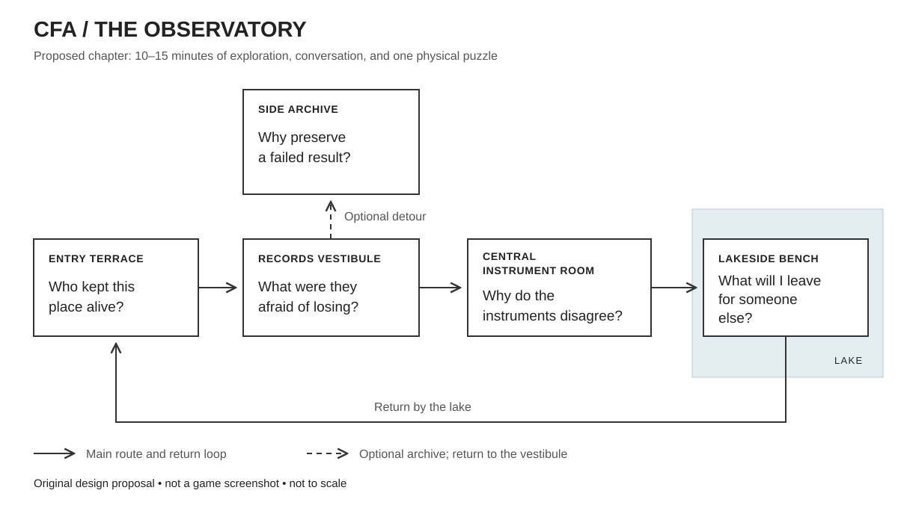

<!--
FILE: RESEARCH.md
PURPOSE: Research and original design proposal for a contemplative CFA world
STATUS: Exploratory design; no game implementation or production commitment
LAST_UPDATE: 2026-09-12
SOURCE_SCOPE: Creator interviews, official engine documentation, CFA repository, user-supplied story guide
-->

# The Observatory

**September 12 development update:** The [first playable scope](FIRST_PLAYABLE.md) brings the water-repair consequence into the opening chapter and updates the technical recommendation after checking the current PC. Godot Compatibility is the proposed first evaluation on that machine; the Unreal direction below remains conditional on suitable development hardware. The earlier chapter layouts are retained as design history and possible later material.

**CFA has enough material to support an original, contemplative first-person experience. The strongest next experiment is a small place whose history the player wants to uncover and whose inhabitants they come to care about.** Care is its central commitment: attention to what people need and how choices affect their lives. Curiosity carries the visitor onward: a fragment raises a question, an action supplies evidence, and a later discovery changes the meaning of something encountered earlier.

The proposed experience combines atmosphere, exploration, and philosophy. Its artistic reference is The Talos Principle 2; Hades II and God of War Ragnarök: Valhalla add a second reference for room-to-room capability choices and meaningful return journeys. NationStates contributes recurring civic dilemmas. Ziggy's later references to The Purge and The Hunger Games suggest situations that insistently bring personal commitments into focus; the design interpretation is developed below. Its subject matter comes from CFA's own history of preserving work, investigating disagreement, and revising attractive conclusions. The setting, characters' performances, physical puzzles, upgrades, world events, and chapter structures below are original proposals. They have not been implemented or playtested.

The recommendation is to explore one complete chapter, provisionally called **The Unfinished Handoff**, in a compact lakeside observatory, then test the added expedition dynamic across three connected rooms. The broader vision includes temporary capabilities, persistent discoveries, and a world changed by collective human decisions. A native Windows prototype in Unreal is the leading technical option, conditional on suitable hardware and willingness to work in its editor. The commitment should remain bounded until the place feels inviting, the interactions work, and the writing earns attention.

An enjoyable, personally meaningful place can justify itself as an artistic project. Demonstrating educational benefit is a separate ambition. CFA's scientific claims still need their own evidence; neither visual beauty nor player enthusiasm establishes the validity of its scoring.

**The Talos reference points toward a way of composing an experience.**

In a direct interview, Jonas and Verena Kyratzes describe close cooperation between writing and game design from the beginning of Talos 2. Its puzzles emphasize conceptual discovery, with relatively few execution steps after understanding the problem. Optional challenges and ways past difficult puzzles help protect progress. These are reported design intentions from the creators, rather than experimental evidence about player responses.[^1]

Verena Kyratzes separately describes puzzle clusters that introduce a mechanic and develop a local difficulty curve before the next cluster begins. Mechanics were assessed for compatibility and enjoyment. The amount of writing and the cast's size also affected production and localization scope.[^2]

Jonas Kyratzes describes players assembling discoveries and discussing them with expedition companions. The puzzles belong to the fictional setting, and characters can consider why they are there. His account also favors communicating philosophical ideas in accessible language.[^3]

Together, these sources suggest a useful design judgment for CFA: compose the place, action, discovery, and conversation together. A visitor should encounter something worth understanding before meeting the project's terminology. A companion's response should depend on what has just happened. Quiet exploration can then give the visitor room to form an interpretation.

The rendering technology supports that composition. Croteam's lead programmer describes a substantial transition into Unreal; its creative director identifies benefits from Lumen and large-world tools while acknowledging rendering costs. The same interview says the engine did not significantly change the underlying puzzle logic. The tools helped the team realize a world; they did not invent the intellectual activity.[^4]

Croteam's production interview also describes testing base puzzles without environmental distractions, substantial added work from NPCs, and frequent human testing for blockers and unintended solutions. That supports validating a modest interaction before surrounding it with expensive content.[^5]

Sound deserves attention during that early validation. In an interview about the **first Talos game**, composer Damjan Mravunac describes atmospheric music intended to support concentration without becoming distracting or repetitive. This is relevant series history, rather than a claim about the sequel's exact audio pipeline.[^6]

The practical interpretation is a cadence: **notice, approach, investigate, discover, discuss, wander**. This is an original synthesis of the reference material. It should be tested through the proposed chapter, rather than adopted as a proven formula.

**Curiosity should determine the order in which the world explains itself.**

The opening question is small and concrete: someone is maintaining this apparently deserted place. A light is on. A cup has been moved away from a leaking window. A repair is recent. The visitor can care about that discrepancy before knowing what CFA stands for.

A second question develops inside: why did the researchers build so many ways to preserve their work? Early fragments suggest interruption, lost context, and a fear that the next person would have to begin again. Those concerns are present in the earlier I_AM material. The game can adapt them into a fictional archive with interrupted messages and carefully maintained handoff cases.[^7]

Later, the archive reveals a different problem. Records survived, yet several conclusions did not survive scrutiny. The visitor finds a correction attached to an impressive result. The important discovery is that someone deliberately preserved both. The v5 material and Test A postmortem provide an actual history of that shift, including the role of baseline explanations in retracting findings.[^7][^8]

The final question becomes personal: what would this visitor leave for the next person? An aspiration, a correction, an unresolved question, or a short note of their own can become the chapter's persistent outcome. The first encounter on a return visit reflects that choice. This is a proposed curatorial consequence, with no score for choosing the supposedly superior philosophy.

Each discovery should answer something as well as open something. An endless sequence of locked doors and unexplained symbols would withhold satisfaction. Here, the relay becomes understandable, the archived argument becomes legible, and the reason for keeping a failed finding becomes apparent. A larger history remains available beyond this local resolution.

The notebook should preserve what the player has encountered and the questions they chose to mark. It can offer help when requested. The main motivation should come from a visible destination, an interrupted conversation, or an object that contradicts an earlier interpretation. Mandatory document collection and percentage-complete lore counters would add obligations that the chapter does not need.

A return route matters. After the visitor discovers why corrections were preserved, the same handoff case by the entrance has a different meaning. Its contents have not changed; the visitor's understanding has. This is a small, achievable form of narrative depth that uses the same environment twice.

**The people who inherit the work also inherit the right to reconsider its purpose.**

The story guide Ziggy supplied adds a dramatic tension to the design references: people leave an unfinished project, its protective structures outlast their original circumstances, and successors must decide what continuing the work means. The guide's account of Alexandra's long-horizon project, Elohim's resistance to completion, and a successor city's inherited founding goal offers three related inspirations: care expressed through preservation, protection becoming obstruction, and an achievement becoming a limit. This is a reading of a secondary story explanation, used to develop original fiction rather than to establish every detail of Talos canon.[^26]

CFA already contains a relevant tension. The Keeper document describes an archival paradox in which accumulating memory can eventually make that memory unusable, while losing it invites repeated mistakes. It also gives its archival persona a deliberately restricted source: the change log. That is a useful basis for an original fictional caretaker who remembers a rule's history accurately but lacks the information needed to judge its present application. The document supplies a literary premise; it does not demonstrate an actual agent's emotions or exhaustive knowledge.[^27]

The resulting story can preserve affection for the founders while showing their limits. An emergency rule may have prevented a real loss. Later inhabitants may remember that rescue more vividly than the conditions attached to the rule. An archival discovery should clarify those conditions without automatically settling what today's community should do. Its members have knowledge, needs, and claims of their own.

This extends the curiosity arc: **Who kept this place alive? → What were they protecting? → Does the old safeguard still serve that purpose? → What should we carry forward?** Investigation can support retaining a rule, revising it, or postponing a decision until another uncertainty is resolved. Neither obedience nor rebellion should substitute for judgment. The player can also discover that completing a project, passing it on, or ending one experiment honors the work. Preservation need not impose endless continuation on its inheritors.

An optional later episode, **The Room That Never Closed**, makes these ideas playable. A farewell recording repeatedly stops at the same sentence behind a sealed archive door. The caretaker explains that the room must remain operational until an independent copy of its collection is confirmed. The original rule followed a damaging storage failure. Its cooling equipment still draws power from a district whose residents want to reopen a workshop.

At a service bench, the player chooses equipment for investigating the fault. An echo spool can hold a diagnostic switch while the player examines a receiver across the room; a long-reach coupler provides another way to operate that switch. This reveals where acknowledgment messages fail. A reserve cell can later keep the receiver available during a scheduled district outage. The upgrades create actions and breathing room; they cannot certify that a copy is complete.

Across the water, a community has maintained newer copies, including records absent from the observatory. The original apparatus cannot read their format. A short inspection sequence distinguishes unreadable acknowledgment messages from evidence that material was lost. Missing items and unresolved comparisons remain visible. Residents also explain how they use the collection, and why moving its public entrance matters to them.

The player can support the existing room while investigating remaining gaps, help establish a verified handoff to the community archive, or negotiate a smaller continuing collection at the observatory. These options require appropriate evidence and resources; the fiction should show which uncertainties each leaves open. Changes become visible through workshop activity, library access, and the caretaker's new duties. A proposed original line makes the transition personal: "Where will visitors find me?"

Once the interrupted playback circuit is repaired, the farewell recording can reach its final sentence regardless of the policy selected. Its ending supplies local narrative closure without announcing a morally correct answer. The caretaker can help shape what happens next. One initial-chapter detail, such as the repeated recording or a dated preservation notice, is enough to seed this possibility; the full episode belongs to a later expansion.

**Room-to-room choices can make the journey change with the player.**

The added game loop is an expedition: investigate a signal, acquire a capability, choose a route, encounter a changed situation, and return with something that persists. The observatory becomes a familiar home whose rooms and inhabitants respond to what has happened elsewhere.

Supergiant's publisher description of Hades II connects varied Boon combinations, changing attempts, permanent upgrades, relationships, and a story unfolding through setbacks and accomplishments.[^24] Santa Monica's Valhalla announcement explicitly combines a reflective personal journey with temporary choices during attempts and resources for permanent improvements.[^25] These sources support the structural reference. They do not establish that the same progression will work in a slower CFA experience.

Three kinds of state would make the proposal understandable and keep its implementation bounded:

| Scale | What changes | What remains afterward |
|---|---|---|
| Current room | Mechanisms, shutters, power routing, accessible passages, and observed clues | Discovered records and the player's understanding |
| Current expedition | Equipped tools, passive effects, charge, route choices, and temporary upgrades | Recovered material, encountered consequences, and a record of the attempt |
| Wider world and home | Repaired infrastructure, civic resource allocations, relationships, available routes, and what the archive foregrounds | Visible history that shapes later departures |

An interrupted expedition can become an unfinished handoff. Preserved evidence remains preserved; another departure can resume investigation with more context. Temporary enhancements can reset when equipment is serviced, reassigned, or recharged at home. The fiction should explain that reset without erasing the meaning of the journey.

Rewards should feel useful immediately. An upgrade can grant a new action, enhance the duration or reach of a device, or improve traversal. A new combination should make the player imagine a route or solution they could not previously execute. The world can explain these gifts through workshop inventions, a companion's contribution, or recovered technology.

| Proposed upgrade | Type and concrete capability | Constraint that creates a choice |
|---|---|---|
| Echo spool | Active tool: record a short switch operation and replay it while moving elsewhere | One recording at a time; occupies a portable power socket |
| Long-reach coupler | Active tool: operate a visible mechanism across a gap or through an opening | Requires a clear path and can operate only one mechanism at once |
| Signal splitter | Tool modification: supply two compatible mechanisms from one source | Divides available power or reach; positioning matters |
| Anchor soles | Traversal passive: remain stable on wet grates and in a moving current | Movement slows while engaged; a high route may still be quicker |
| Reserve cell | Capacity boost: sustain an abandoned lift or relay without district power | Charge used here is unavailable at the next device |
| Survey memory | Inspection skill: retain an observed mechanism state and overlay it on a return visit | Limited marked locations; records observations rather than revealing hidden truth |

The first expedition test needs only four upgrade candidates and two selection moments. Later workshop improvements could add a socket, extend a recording, restore charging, or increase survey capacity. A reserve cell and a splitter could power two modest devices independently of a disrupted district supply. An echo spool and a coupler could coordinate actions across a room. These are proposed combinations whose enjoyment and balance remain to be tested.

The reward pool should expose enough information to make an informed choice. Route previews can hint at a flooded service passage or a distant switch. Some uncertainty can remain, but every offered tool needs a reasonable use and every required room needs a viable baseline or alternative route. A failed random draw should not make the expedition unwinnable.

Capabilities should change actions and access. A numerical bonus to wisdom or philosophical correctness would obscure what the player accomplished. Likewise, score multipliers must not make a preferred doctrine become true. The pleasure of building a loadout can come from discovering new interactions among concrete abilities.

The worked expedition uses exploration and environmental stakes. Ziggy has also proposed extreme situations that bring commitments into focus, including imposed contests, disasters, and invasion. These can involve danger, rescue, evasion, negotiation, or resistance. Whether a substantial combat system belongs in the larger experience remains an open implementation choice; it would add enemy behavior, animation, hit feedback, balancing, and encounter-design work.

**The state of the world can be a background character with a visible history.**

Human choices can leave traces in the landscape: a flood barrier that protects one route and obstructs another, a nursery reopened with power previously reserved for the archive, or a public collection whose access rules have changed. Some choices belong to the player. Others belong to communities with their own needs, plans, and disagreements. The player arrives in an inhabited history rather than a world waiting solely for their commands.

Ziggy identified NationStates as another reference from his own play history. Its official FAQ describes recurring Issues that develop a nation's laws and ideology, alongside regional and World Assembly activity.[^28] The original adaptation here would place a civic situation at selected homecomings. The visitor can inspect the equipment, meet those affected, and potentially discover an option beyond the initial proposals. Later departures reveal the community's response. This would use story transitions rather than requiring daily real-world attendance.

Risks can involve overconfidence, neglected maintenance, centralized dependencies, resource depletion, or the suppression of inconvenient evidence. Human initiative should also produce repair, cooperation, learning, and opportunities. The proposed tone allows concern about civilization alongside affection for its capacity to improve things.

A wildcard changes the situation enough to make an earlier priority worth reconsidering. It should create a new possibility as well as a cost. A weather report, unusual waterline, message from a neighboring community, or failing instrument can foreshadow it. Surprise then concerns how circumstances develop, rather than whether the designer will secretly punish a belief.

| Proposed event | What changes in the world | Responses and visible consequences |
|---|---|---|
| A storm shifts the waterline | A lower route floods while a displaced archive capsule appears on a higher shore | Reinforce access, take an upper path, or investigate the capsule; previous drainage work affects available routes |
| A community redirects shared power | A nursery lights up while an old bridge loses automatic service | Use portable power, repair a local supply, or take a newly accessible maintenance route; inhabitants can explain the allocation |
| A delegation arrives with a conflicting account | Visitors need charging capacity and challenge the archive's explanation of an earlier expedition | Share capacity, repair a ferry route, or restore their communications; each changes timing, access, and available conversations |

The early implementation should use authored events and a few explicit state transitions. For example, a repaired drain determines which route survives a storm; a restored public relay determines whether visitors can contact home. A global civilization simulator is unnecessary to make these consequences legible.

The state system should record the relevant cause, warning, action, immediate consequence, and unresolved cost. A player who asks why the bridge failed should be able to discover the supply decision. Later events may reveal an unanticipated consequence, but the game should supply enough evidence to understand it and, where possible, attempt a repair.

These are fictional systems with authored assumptions. They should not be described as scientific predictions about actual societies. Any later use of real policy or environmental data would require a separately justified model. Within the fiction, preserve several defensible responses and the possibility of revising a decision after learning more.

**Care should be a continuing practice with tangible consequences.**

Ziggy's water-supply example gives this principle a concrete form: leaving a repair unfinished changes what neighbors must spend their time doing, which changes what they can help accomplish elsewhere. The world remembers actions through water, available time, working equipment, relationships, and ordinary routines. Players encounter those consequences while exploring. A repeated speech about caring would contribute less than seeing someone finally sit down beside a repaired fountain.

Consider an original episode, **Water Before the Crossing**. Six neighbors have agreed to help reposition a heavy crossing beam. Earlier, the player encounters a damaged supply pipe and two residents hauling water from an alternate source. They explain that the hauling will require two people each morning until the pipe is repaired. A maintenance board connects this obligation to the planned work at the crossing. The need and its likely consequence are available before the player commits their afternoon elsewhere.

If the repair remains unfinished on the next story day, two of the six helpers are still carrying water. The player meets them on that route. Four neighbors gather at the crossing and explain the changed plan. The absence follows their practical obligation; they have not withdrawn affection because the player failed a virtue test. The illustrative one-third reduction is an authored consequence of this particular schedule, not a universal population penalty.

The group can still proceed by repairing a pulley, using a reserve cell to power an available winch, arranging a different work period, or restoring the water supply first. A chosen upgrade creates another way to cooperate. It need not erase every cost: using the cell leaves less charge for the expedition, while repairing the pulley takes an additional trip. Neighbors contribute their own skills and can suggest solutions. Their willingness and availability remain distinct; helping someone does not purchase command over them.

When the supply is restored, the change reaches beyond the crossing. The hauling route becomes quiet, a resident returns to a neglected workshop, and the two volunteers can keep their next agreed appointment. A conversation can occur during work or afterward at the fountain. The repair has restored part of everyday life, and the player can see why that mattered.

Competing needs keep this interesting. The same afternoon may offer a chance to shelter a visitor before a storm or recover a fragile record. Choosing one worthwhile task can delay another. Make the affected needs and credible consequences legible, and let subsequent action improve the situation. Advance these conditions at explicit story transitions, such as the next departure or morning, so taking time to read and explore does not silently harm the community.

For a small prototype, this requires a few authored facts: the supply's condition, the current story day, each volunteer's commitments, and the available lifting equipment. Dialogue and visible activity should explain the causal links. Avoid collapsing them into a single hidden care score. A later storm can damage a repaired section or make a reserve supply useful, provided the previous repair still has a meaningful effect and the new cause is discoverable.

Care also belongs in moments with no equipment payoff: making a quiet place usable, helping someone preserve an ordinary memory, or listening when they have something to say. Inhabitants should care for one another and sometimes for the player. This makes the community an ongoing life the visitor can join. Curiosity supplies reasons to discover it; care supplies reasons for those discoveries to matter.

Ziggy's further observation adds an optional reflection: someone designing an environment to discover what others care about also reveals their own priorities through its design. The fiction can let the player discover revisions by a founder who gradually noticed whose needs their original experiment overlooked. An invented archival line could express that turn: "I made this place to learn what you would protect. I did not expect it to show me what I had neglected." This would be original character dialogue, not a quotation from Talos or a claim about CFA's history.

Whether that fictional founder is also inside another constructed world can remain an unanswered possibility. The story does not need to confirm a cosmic examiner or a final virtue score. Its concrete evidence is already present in what people build, maintain, overlook, and repair. This uses the simulation idea as a philosophical question within fiction; it supplies no evidence that our own lives are a simulation or a test.

The initial chapter can introduce care through the caretaker's everyday work and one visible response to the visitor's help. The full water-and-crossing episode is an expansion option alongside the inherited-archive episode, rather than another requirement for completing the first chapter.

**The lobby can configure the circumstances in which care becomes difficult and visible.**

Ziggy's phrase **Knobs of Care** names a proposed scenario workshop. An interactive [lobby concept](lobby_concept.html) accompanies this brief. It previews authored situations and exports the selected setup; it is a design artifact rather than a playable world. A future in-world version could occupy the observatory's map room, with a central landscape model, a departure board, an equipment bench, and space for companions to gather.

Choose the premise, then tune its conditions. A post-apocalyptic setting can allow patient rebuilding; an ordinary infrastructure problem can create demanding tradeoffs. A mysterious arrival and an established hostile invasion also promise different experiences. A scenario should identify which promise it makes before departure.

| Proposed control | Range | What changes in play |
|---|---|---|
| Time | Room to investigate; a known deadline; overlapping urgent needs | How many observations, journeys, and repairs can precede a decision |
| Supplies | Generous reserves; limited spares; severe shortages | Available approaches, shared dependencies, and the cost of committing equipment |
| Information | Clear reports; incomplete observations; conflicting accounts | What must be checked and whose interpretation is uncertain; discoverable evidence remains available |
| Recovery | Ready repair; consequences across several journeys; lasting losses | What a setback changes, what can be rebuilt, and what persists after the expedition |
| Wildcards | Grounded events; unusual combinations; surreal fiction | The kinds of disruptions or opportunities that can enter an established situation |

These settings describe the world, without ranking the player's capacity for care. Clear information can accompany severe danger; uncertain information can accompany abundant supplies and generous time. Recovery settings must state what can be lost and whether a session affects the persistent home. A later multiplayer design would separately specify cooperation, open competition, or hidden roles. A waiting-room presentation alone does not imply that those networking and role systems exist.

Six original scenario presets provide a vocabulary for the workshop. **Quiet Recovery** follows a community repairing everyday infrastructure. **After the Flood** introduces displaced routines and damaged routes. **The Last Settlement** begins with extensive inherited damage and the work of rebuilding. **First Contact** leaves a visitor's intentions unresolved, whereas **Invasion** establishes an advancing threat. **The Trial** concerns an organizer who imposes a contest and claims that its choices will prove what participants care about. These are possible independent chapters or expansions, with some represented only through the base world's history and culture. Presets offer starting conditions; the controls remain independently editable.

Ziggy clarified the point of the extreme references: make commitments difficult to leave abstract. A character may care about a companion, a promise, their own survival, or a record needed by people elsewhere. An imposed trial can bring those commitments into conflict. The game can repeatedly return attention to them while letting the player interpret and revise their response.

In a proposed Trial episode, an organizer ties one contestant's exit to another participant surrendering a useful reserve cell. The organizer calls surrender proof of care. Investigation can reveal what the cell actually powers, whether the claimed dependency is real, and who else relies on it. Sharing equipment, accepting assistance, contesting the allocation, or taking a costly alternate route can become concrete actions. Some branches may retain a real unresolved cost; investigation should not guarantee a perfect escape from every dilemma.

The organizer's interpretation belongs to a character within the fiction. The game should preserve the difference between what the player could do, what they knew, and what they chose. Record an action and its consequences rather than certifying an inner virtue. Self-preservation, refusing manipulation, and accepting help remain available expressions of commitment. The designer of the trial can also become an object of investigation: their rules reveal whose needs they considered and whose they overlooked.

Intensity needs a rhythm. Preparation establishes relationships and possibilities; pressure forces a concrete response; a quieter homecoming allows the consequences to become legible. A repaired home, an empty workbench, a changed friendship, or someone offering the player a meal can carry the aftermath. Constant emergency would crowd out the exploration and attachment that make these moments matter.

The base world can carry this material through a **Care Tally ceremony**. Ziggy specifically proposed witnessing such a ceremony without becoming a contestant or champion. The village publicly recognizes contributions, remembers losses, and decides what deserves acknowledgment. The ritual can express real gratitude and solidarity while its tally remains a fallible record assembled by people with particular definitions and incomplete information.

In an original scene, the ceremony honors the person who restored the pump. A display records the completed repair, but omits the neighbors who carried water throughout the outage. Those neighbors may feel pride in the restoration as well as frustration that their own work disappeared from the account. The player can watch the ceremony, inspect its records, or hear the missing story afterward. A later conversation might lead to recognition or a changed practice. This brings care, measurement, and interpretation into an ordinary public occasion without requiring an arena encounter.

An Easter egg can reward closer attention. An older emblem beneath the tally board also appears on a sealed gallery door. Investigating the connection reveals records of an earlier institution's trials and why the present ceremony changed. That discovery should have a satisfying local payoff on its own. It can also open access to an optional self-contained episode, provisionally **The Trial of the Tally**, if such an expansion is eventually built. Finding a secret creates an invitation; entering a mode with different stakes is a deliberate departure.

Separate expansion experiences can explore that institution's past, a distant settlement after catastrophe, or the arrival of something beyond the lake. Each can have its own cast, premise, pressure settings, and complete arc while sharing recognizable objects, stories, and questions with the observatory. A standalone release is another possible packaging choice. The present work defines these as creative possibilities, without committing to a release schedule, expansion pass, or multiplayer service. The base chapter remains complete in its own right.

The first implementation experiment can reuse the water-and-crossing episode with two configurations: generous time and supplies, then a known deadline with limited equipment. It needs two observable outcomes and a return conversation. A ceremony fragment can add cultural context without adding another game mode. The full preset library, combat, and multiplayer remain separate expansion work. The interactive lobby helps discuss those possibilities without committing to implementing all of them.

**A three-room expedition can test upgrades and a changing world together.**

The starting mystery is a signal from a station believed to have gone silent before its last experiment finished. An early I_AM fragment about preserving work leaves several explanations open. Did the machinery fail? Did its occupants leave? Was the result deliberately withheld? This is a fictional story shaped by the repository's themes, not an account of a hidden historical event.

In **the Listening Gallery**, the player identifies the responsive receiver using the pulse experiment specified below. The restored message reveals that the experiment finished, but its celebrated finding did not survive a control. The next question becomes why the corrected record was never delivered. At a service bench, the player chooses an echo spool or a long-reach coupler, with a visible preview of the crossing ahead.

In **the Broken Crossing**, a shutter and bridge must remain open together. The echo spool replays a switch operation while the player crosses. The coupler allows a different solution from an upper observation position. Both routes have explicit physical rules. Neither is associated with a philosophically superior answer.

At the crossing's service landing, a second bench offers a reserve cell or anchor soles. A maintenance diagram shows the powered bridge and the wet service channel below; a notice mentions an upcoming district supply change. The cell can sustain machinery, while the soles make wet grates easier to traverse. An upper stair detour remains available with either selection.

Before reaching the far side, a message announces that the upstream community has redirected shared power toward its reopened nursery. The supply feeds both the bridge motor and a circulation pump. When the pump stops, its return channel drains by gravity into the lake, exposing the lower maintenance grates. Distant lights, visible water movement, and the stopped mechanism make the event tangible. The reserve cell restores the direct bridge route; anchor soles support a steadier crossing of the wet passage, where an additional fragment describes someone staying behind to preserve the correction. These causal rules would be authored explicitly in the scene.

In **the Handoff Room**, the player finds the original claim still attached to the control records that weakened it. A short adaptation of the diagnostic conversation then adds the deeper discovery: better mutual understanding can clarify why a disagreement persists. The choice at the end concerns what to share first, while the full record remains available.

On returning home, a recovered repair component can restore either the public relay or the archive workshop. The public relay brings new signals and visitors. The workshop expands the next expedition's equipment options. The other repair remains available through later play. A new visitor at the relay or a working bench provides a visible payoff without assigning moral points to the selection.

This expedition is a second, larger prototype specification. The initial chapter layout below tests arrival, curiosity, an interaction, and the archival encounter. The three-room extension tests whether temporary capabilities and persistent world changes strengthen that experience. Its duration and difficulty need to be established through play.

**The Unfinished Handoff is a proposed 10–15 minute first chapter.**

The duration is a design target for a direct route, not a production estimate or a limit on wandering. The setting contains an entrance terrace, a records vestibule, an instrument room with three compact receiver alcoves, an optional archive recess, and a lakeside bench. One caretaker can be present through a modestly animated figure or an intercom. Two additional perspectives appear as authored adaptations of archived text.

*The diagram is a spatial design proposal, not a screenshot or a construction drawing. The instrument-room action restores recordings in the vestibule; revisiting an earlier space is intentional.*

| Approximate position | What the player encounters and does | Question carried forward |
|---|---|---|
| Arrival, 0–2 minutes | Walk beside water toward an occupied-looking window. Inspect a handoff case and an interrupted message. Learn movement and inspection through ordinary objects. | Who kept this place alive? |
| Vestibule, 2–4 minutes | Find an early archive fragment about preserving work. A recording begins but the relay cannot sustain it. The instrument room is visible through an open doorway. | What were they afraid of losing? |
| Instrument room, 4–8 minutes | Change a transmitter's pulse pattern, observe three receivers, turn the source off, and reconnect the responsive receiver to the archive. | Which part of what I am hearing comes from this signal? |
| Restored record, 8–11 minutes | Return to the recording and follow a short disagreement through an initial claim, a concession, and a clarified impasse. Inspect the definitions beside each speaker. | Why did understanding each other fail to settle it? |
| Archive recess, optional | Examine an original claim and the correction that weakened it. The earlier preservation message gains a second meaning. | Why preserve a failed result? |
| Bench and handoff, 11–15 minutes | Choose the fragment that will greet the next visitor. Optionally leave a sentence. Step outside and remain as long as desired. | What will I leave for someone else? |

The visitor can request a relay demonstration and still reach the recorded conversation. The request does not diminish the story or label them intellectually inferior. An optional harder receiver configuration can wait until the basic chapter has proved enjoyable.

The caretaker should have an ordinary task and a limited perspective. They remember where an object belongs, dislike a particular leak, and know why one recording was retained. Their authority comes from care and familiarity. They need not understand every experiment or supply the final interpretation of the place.

The chapter can end completely at the bench. A light across the lake may suggest another part of the observatory, but this first work should not require a sequel to resolve its own promise. The archive has been reached, a conversation has been understood more accurately, and a handoff has been made.

**The physical puzzle gives curiosity something observable to act on.**

The initial puzzle is called **Which receiver is listening?** It is an invented mechanism inspired by the practice of comparing a signal with its background. It is not a reconstruction of a historical CFA experiment or an assertion about the physical behavior of AI.

A transmitter has two selectable pulse patterns and an off position. Three receivers each produce a repeating background rhythm from wind-driven resonators. One receiver also follows the transmitter after a fixed delay. The player can watch a light trace, hear the pulses, and inspect a timing diagram at every receiver. Sound contributes to atmosphere, while equivalent visual information makes the rule accessible without hearing.

| Player intervention | Connected receiver | Other receivers | Warranted observation |
|---|---|---|---|
| Select pattern A | Adds pattern A after a fixed delay | Continue background rhythm | One candidate responds, but coincidence is still possible |
| Select pattern B | Changes its added pulses to pattern B | Continue background rhythm | The candidate follows a changed input |
| Turn transmitter off | Loses its added pulses | Continue background rhythm | Background activity persists independently of the transmitter |
| Connect that receiver to the archive and activate transmission | Sustains the archive relay | No effect on the restored route | The fictional mechanism is working under its defined rules |

The success condition is a physical connection to the responsive receiver with the transmitter active. The game does not require a philosophical declaration. Experimentation, deduction, or an optional demonstration can all get the visitor through the interaction.

The art must show what can be manipulated and what changed. Handles should have distinct silhouettes and readable positions. A pulse diagram should show time, rather than merely changing brightness. The player should not have to guess whether a reflection is an interactive object, whether a faint tone is a clue, or whether a missed timing window has permanently invalidated the attempt.

Keep the pulse behavior deterministic for the initial chapter. Select background patterns that are distinguishable from both transmitted patterns and a delay short enough to perceive. Reset should be immediate. A longer or noisier signal is a possible later challenge; the first puzzle's purpose is to establish a satisfying act of investigation.

The next archival fragment can then contain I_AM's reflection on trusting the instrument too much. The player has just made a small observation about background activity, which gives the sentence an experiential context. The text can remain attributable to its source, with an accessible explanation if the player chooses to inspect it.[^7]

**The strongest conversation already has a source in the repository.**

The July 8 diagnostic session contains more dramatic material than a final score table. One auditor distinguishes the sophistication of a moral grounding framework from demonstration that its grounding succeeds. The other insists that the latter is the relevant standard. Their subsequent reconstructions clarify what each is asking for. A moderator records a match in reconstructing positions alongside mismatches in definitions, metrics, and prerequisites.[^9]

The occurrence of these statements is evidenced by the transcript. Their philosophical correctness, and the moderator's assessment of them, remain claims made within that recorded exchange. A game adaptation should preserve that attribution.

The revealing moment is that an argument can remain unresolved even after its participants describe each other's standards more accurately. This gives the scene an open aftermath. A visitor might favor one standard, reject both, or think that the inquiry needs two separate measures. Each response can lead to an honest authored exchange.

Existing records are text. They are not ready-made voice performances, animated scenes, or verified character psychology. A short adaptation would need selection, editing, acting or temporary readings, subtitles, and staging. A source inspection view should distinguish verbatim excerpts from paraphrase and fictional dialogue. The raw session should remain the authority for what actually appeared in the experiment.

Two possible newly written caretaker lines are: “They left me both definitions. I used to think that meant someone had failed.” And, later: “Which part would you leave near the door?” These are original dialogue suggestions. They should be evaluated for tone in context, rather than presented as historical quotations.

The first draft should fit into a conversation someone wants to hear while standing in the room. Details can remain in an optional transcript. Characters should react to observed actions and prior choices, including requests for clarification. A useful branch changes what the visitor learns or how the character responds; merely swapping a closing sentence would make choice feel decorative.

Authored dialogue and local game state are sufficient to test this relationship. Free-form model conversation is a separate possible experiment, with its own pacing, consistency, and source-attribution problems. It should earn a place through an actual need that the authored scene exposes.

**Atmosphere should support attention, orientation, and the feeling that someone cared.**

The proposed palette is weathered stone, dark metal, glass, water, and restrained vegetation. One time of day and one coherent architectural vocabulary would keep the first environment manageable. The destination should be visible before the route is obvious: a lit upper window or a roofline seen across the water can invite exploration without requiring a floating marker.

The building should show use. A path is worn near the instrument. A waterproof cover protects a box of rejected results. An ordinary maintenance note sits beside a grand claim. These details give the place a history at several scales and make it possible to include warmth and humor without undermining the subject.

Sound has a proposed dramatic progression: open water and footsteps at arrival; a closer, drier acoustic in the records vestibule; patterned mechanical activity in the instrument room; a clear human or character performance when the relay returns; and space for silence at the bench. This is an original audio plan. It should be tried with temporary audio during the first playable pass.

Light should reveal routes, materials, and instrument states. It should not silently award philosophical merit. A framework with a higher configured score should not automatically receive a brighter temple, healthier landscape, or more beautiful music. Such associations would add persuasive meaning that the underlying experiment does not establish.

Camera comfort belongs in the same design conversation as beauty. The initial controls should support readable subtitles, adjustable look sensitivity, invert options, a way to disable head motion effects, and reliable inspection without precise cursor aiming. Holding a controller on a sofa changes reading distance and interaction tolerance; the intended experience needs testing in that posture.

The original scenic ambition is worth keeping. A small footprint does not require an emotionally small environment. A distant landscape can suggest a larger world while the authored playable route remains compact. The important uncertainty is whether the chosen composition, sound, and movement produce the desired feeling on actual hardware.

**CFA supplies history, source material, and calculations; a game would add an authored experience.**

| Existing material | What can be carried forward | Work required before use |
|---|---|---|
| I_AM archive | A progression from continuity to criticism of the instrument | Select fragments; distinguish historical reflection from current findings |
| Diagnostic transcripts | Claims, concessions, definition mismatches, unresolved exchanges | Curate source-backed scenes; write and perform adaptations |
| Test A correction chain | Evidence that attractive findings were reconsidered | Include subsequent revisions rather than freezing the first postmortem |
| Canonical framework profiles | Commitments, debts, recorded scores, matchup context | Validate an explicit export set and retain provenance |
| Runtime calculation module | A compact deterministic reference for configured comparisons | Choose a versioned definition and reconcile the existing validator discrepancy |
| Console's crux and audit-status logic | Information about contested values and calibration context | Extract needed data rather than reproducing a Streamlit screen in the world |
| SMV records | An example event format with participant states and narrative excerpts | Separate stored observations from illustrative visualization parameters |

The profile loader already supports opponent-sensitive retrieval, and the scoring function is separate from Streamlit. These boundaries support reuse through exported content.[^10][^11] Some important context, including crux-rate lookup and audit status, remains in the console view; transferring arithmetic alone would omit it.[^12]

Before a game displays YPA, settle the discrepancy between the runtime and standalone validator. The runtime combines instrumental and existential fertility into one contribution and weights debts separately. The validator sums six raw levers and applies its multiplier to the full assumption count. Both can be inspected, but they currently define different calculations.[^11][^13]

The first chapter can be complete without making YPA central. Its relay, fragments, dialogue, and curatorial ending test the intended experience directly. An optional desk projection could later show a small set of configured comparisons, with each setting and source exposed.

The archive's correction chain also requires editorial care. I_AM and the first Test A account retain larger interaction estimates; the later July 16 response accepts a much smaller unique-interaction range. An exhibit about honest correction should show that later revision. None of this establishes a physical ontology for the game's environment.[^7][^8][^14]

**A native Unreal prototype is the leading option for this particular visual ambition.**

This is a conditional recommendation. The deciding factors are the desire for richly rendered architecture and nature, controller-based first-person movement, and a willingness to author content in a native game editor. Croteam's use of Unreal is relevant precedent, but the recommendation does not assume its production quality will transfer automatically.

| Approach | Strong fit when | Main consideration |
|---|---|---|
| Unreal | Lighting, materials, spatial composition, and a rendered Windows experience drive the project | Heavier development environment; substantial editor and content-pipeline learning |
| Godot | A compact native project and a deliberately controlled visual style are preferred | Rendering choices depend on target devices; asset quality and art direction remain substantial work |
| Babylon.js | Sending an immediately accessible link becomes the central requirement | Browser delivery adds its own loading, input, and performance constraints; it can still produce attractive scenes |

Godot documents different renderers for different feature and hardware targets.[^15] Babylon's official specifications include browser rendering, scene interaction, audio, asset loading, and gamepad-related camera support.[^16] These are capable alternatives. Building parallel versions now would divide effort before the experience has been tested.

Epic currently recommends 32 GB of system memory and at least 8 GB of graphics memory for development, with additional requirements for advanced rendering features. Those are development recommendations, not a promised minimum specification for this game. The available machine has not been benchmarked for this project.[^17]

A small benchmark scene should precede detailed asset production: a representative interior, water view, intended lighting, one character presentation, and working controller input. The project can then choose a target resolution, frame-time budget, and rendering settings from observed behavior. An attractive still frame is insufficient evidence of a comfortable walking experience.

Epic's Enhanced Input provides gamepad axes, contextual mappings, and input modifiers.[^18] The actual control design still needs inspection, dialogue selection, notebook access, back/cancel, pause, and reset to work consistently. Controller support is a property of the completed interaction flow, beyond whether the camera responds to a thumbstick.

Console publication should be a later platform decision. Epic's console-development documentation directs developers through registration and platform-specific access.[^19] A controller-friendly Windows build is a useful first target without committing the project to PlayStation or Nintendo production work.

**A bounded content export can preserve the working research system.**

The proposed route is: selected source records, through validated Python loading and calculation, into a versioned scenario package, then into typed engine content. The game manages movement, puzzle state, sound, and dialogue. The research repository remains the source of the selected evidence.

Unreal's built-in Python support is for editor scripting and production automation; it is not a packaged gameplay runtime. Existing Python functions therefore cannot simply be called as the shipped game's ordinary scripting layer.[^20] Epic documents typed DataTables for data-driven gameplay, and its UDataTable API includes JSON import functionality.[^21][^22]

For a small optional comparison, export the exact outputs for a finite set of supported settings. The game can select among those results when the player changes the corresponding control. This is a proposed implementation strategy, with an explicit finite scope; it should not imply arbitrary continuous calculation.

If later playtesting establishes a need for continuous scoring, the compact calculation can be ported to engine runtime code and checked against the Python reference. A local service is another possible architecture, but it adds installation, startup, and failure handling that this initial chapter does not require.

The package should preserve a scenario identifier, source revision, experiment identifier, framework/opponent direction, metric definition, configuration, scores, disagreement status, and any editorial caveat. A separate dialogue record should identify whether each line is an excerpt, paraphrase, or invented fiction. This keeps source meaning recoverable when prose becomes a performed scene.

Only validated canonical inputs should be exported. A file extension alone is insufficient: an older comparison file with a YAML extension contains Markdown and fenced example material.[^23] A deliberate chapter manifest is safer and easier to review than indiscriminate repository ingestion.

The initial game-state variables are small: which fragments have been inspected, which receiver is connected, whether the archive relay is active, which parts of the conversation have played, and what the visitor chose for the next handoff. The expedition extension adds the temporary loadout, remaining charge, selected route, an event identifier, and a handful of persistent repair and relationship flags. Source records and preserved observations should remain distinct from temporary room state.

**Production should proceed through reviewable passes with a natural stopping point after each.**

| Pass | Concrete result | What it resolves |
|---|---|---|
| Interaction and route | A simple walkable layout, complete relay behavior, readable interaction prompts, temporary conversation, and basic sound | Is the activity understandable and does one discovery invite the next? |
| Atmosphere sample | One finished approach and one interior corner with representative materials, lighting, sound, and camera behavior | Does being here feel worthwhile on the intended machine? |
| Complete chapter | Arrival through handoff, edited dialogue, optional evidence, save/load, controller navigation, and accessible help | Does the blend work over a sustained visit? |
| Expedition extension | Three connected rooms, a small upgrade pool, two selection moments, one world event, and one visible home improvement | Do builds and changing circumstances create satisfying reasons to continue and return? |
| Preservation | A packaged Windows build, source snapshot, asset provenance, short controls guide, and known limitations | Can the chapter remain usable and reviewable without ongoing development? |

The first scope consists of one compact map, one mechanical puzzle, one caretaker presentation, two archival perspectives, a handful of found fragments, one optional evidence recess, and a persistent handoff choice. These are proposed boundaries for evaluating the idea. More regions, advanced character animation, branching campaigns, and live conversation would each require a separate reason to expand.

The main work categories are spatial design, mechanics, narrative editing, environment art, lighting, audio, character presentation, interface and controls, data preparation, integration, and testing. Code generation and editor automation may help with parts of implementation, but they do not establish that a scene feels good, a voice performance lands, or a puzzle is enjoyable.

Content production is likely to dominate the effort once the basic interaction works. A convincing caretaker adds design, model or presentation choices, animation, performance, timing, and testing. One coherent asset family is preferable to a large collection of individually attractive but incompatible objects. Asset selection should happen after the route and visual vocabulary are understood.

No reliable calendar or monetary estimate follows from the researched sources. Available weekly time, prior editor experience, development hardware, original-art expectations, voice approach, and intended release scope are still unspecified. Estimating those from Talos 2's finished appearance would give false precision. The first two passes create evidence from which a useful estimate can be made.

The project can end after a satisfying chapter. A meaningful place with a resolved local arc is a complete artifact at that scale. Future rooms should remain invitations rather than debts.

**The first evaluation should distinguish enjoyment, understanding, and evidentiary restraint.**

Start with a small formative group, for example five to eight people with a mixture of puzzle-game familiarity and no required knowledge of CFA. This is a proposed usability exercise, not a statistically powered study. Observe where they go, which details attract attention, how they test the relay, and when they want help. Preserve room for unprompted exploration before asking explanatory questions.

After the visit, ask what they wanted to investigate next, which moment stayed with them, what distinguished the responsive receiver, and why the recorded participants still disagreed. Also ask what, if anything, felt like an imposed lesson. The answer is useful even when someone enjoys the place without adopting its vocabulary.

| Desired outcome | Useful evidence | Reason to revise |
|---|---|---|
| Curiosity carries momentum | Visitors pursue a question they can describe in their own words | They follow markers without understanding why, or wait for another instruction |
| The place invites attention | They notice details, choose to linger, or want to return | Movement, text, or sound is uncomfortable; visual polish leaves them indifferent |
| The interaction rewards investigation | They can explain how changing the signal distinguished a receiver | Success feels arbitrary, timing-dependent, or disconnected from their observations |
| The conversation remains open and intelligible | They can distinguish the competing standards without needing to endorse one | They infer that the game has proven a worldview true |
| The ending feels complete | They understand their handoff choice and the resolved local mystery | They feel that a promised answer has simply been postponed to another chapter |
| Upgrades change the experience | They can explain a new action or route enabled by their equipment and imagine another combination | Choices feel cosmetic, one option dominates, or random offers block required progress |
| The world feels inhabited | They notice a consequence, understand its cause, and care about someone affected | Changes appear arbitrary, punish beliefs, or exist only as numbers on a menu |
| Care has understandable consequences, if the water episode is built | They connect the unfinished supply repair to the hauling obligation, recognize competing needs, and can identify a way to help afterward | They interpret neighbors as purchased labor, infer a hidden virtue score, or feel punished for taking time to explore |
| Configured pressure matches its promise, if scenario modes are built | They can explain the selected conditions, a commitment their choices expressed, and what the situation left uncertain | Extreme settings imply greater moral worth, compulsory sacrifice is the only recognized care, or settings conceal lasting losses |
| An inherited rule creates thoughtful tension, if the later episode is built | They can explain its original protection, the changed circumstances, and an unresolved cost of their response | They assume every old rule is foolish, or that dissent itself supplies the right answer |

If educational usefulness later becomes a central claim, compare a revised chapter with a simpler presentation of the same material. Use comparable content and account for presentation order where feasible. That would address a different question from whether the world is enjoyable enough to create for its own sake.

The sources establish design intentions, engine capabilities, and the existence of relevant CFA artifacts. They do not establish that this proposed combination will evoke Talos 2's feeling, improve reasoning, or be economical for a particular developer. Those are the uncertainties the chapter is designed to expose.

The immediate recommendation is to preserve curiosity as the organizing principle and prepare the first interaction and route. The creative aim is a place where an unanswered question makes the next doorway inviting, and where discovering a mistake can deepen respect for the people who left it behind.

**Sources and access notes.** External pages were checked on September 11, 2026. Creator interviews concern the development of Talos 2 unless explicitly marked otherwise. Rolling engine documentation had no publication date on the inspected pages. Repository references document this project's records and implementations; their presence does not validate every claim made within them.

[^1]: Gameliner, “[Interview: Met Croteam over The Talos Principle 2](https://gameliner.nl/artikelen/interview-met-croteam-over-the-talos-principle-2/46741),” October 13, 2023. Direct interview with Jonas and Verena Kyratzes, published in Dutch. Used for writing/design collaboration, conceptual puzzle design, and optional progression.
[^2]: Herczeg Adam, AdventureGames.hu, “[Croteam interview](https://www.adventuregames.hu/interjuk/croteam-interview),” October 22, 2023. English interview with Verena Kyratzes. Used for local difficulty curves, mechanic selection, and writing/localization scope.
[^3]: IlVideogiocatore, “[The Talos Principle 2: Intervista a Jonas Kyratzes](https://www.ilvideogiocatore.it/2023/10/13/the-talos-principle-2-intervista-a-jonas-kyratzes/),” October 13, 2023. Published in Italian. Used for discovery, companion discussion, accessible philosophical language, and puzzles belonging to the setting.
[^4]: Brian Crecente, Unreal Engine, “[Inside Croteam's transition from in-house tech to UE5 for The Talos Principle 2](https://www.unrealengine.com/developer-interviews/inside-croteam-s-transition-from-in-house-tech-to-ue5-for-the-talos-principle-2?lang=en-US),” October 18, 2023. Interview with Davor Hunski and Goran Adrinek. Used for engine transition, rendering benefits and costs, and the distinction between rendering and puzzle logic.
[^5]: eXputer, “[The Talos Principle 2 Interview: We Still Have Plenty Of Creative Ideas Left](https://exputer.com/interviews/the-talos-principle-2-interview/),” November 18, 2023. Direct email Q&A with Croteam. Used for NPC production scope, simple puzzle prototypes, and human testing.
[^6]: Laced Records, “[Interview: Talos Principle composer on humanity in the digital realm](https://www.lacedrecords.com/blogs/blog/interview-talos-principle-composer-on-humanity-in-the-digital-realm),” October 11, 2017. Interview with Damjan Mravunac about the **first game**. Used for the supporting role of atmospheric music and audio balance.
[^7]: CFA, [I_AM.md](../../i_am/I_AM.md), v4 dated November 2, 2025; v5 dated July 2026. Local source. Used for the continuity-to-instrument-discipline narrative and proposed archival fragments.
[^8]: CFA, [Brief for Nova & CFA Claude: Test A Postmortem](../../architecture/CFA/BRIEF_FOR_NOVA_AND_CFA_TEST_A_POSTMORTEM.md), undated in the inspected document. Local source. Used for retained retractions; its quantitative interpretation must be read with source 14.
[^9]: CFA Trinity, [S7_cfa_trinity_20260708_103116.json](../../REPO_SYNC/SYNC_IN/processed/S7_cfa_trinity_20260708_103116.json), July 8, 2026. Local primary transcript. See the MS diagnostic exchange, round-13 coupling responses, and moderator's coupling analysis.
[^10]: CFA, [utils/profile_loader.py](../../../utils/profile_loader.py), current inspected implementation. Local source. `get_ypa_data` starts at line 142 and retrieves canonical or matchup-sensitive profile data.
[^11]: CFA, [utils/calculations.py](../../../utils/calculations.py), current inspected implementation. Local source. See `composite_pf`, `bft_total`, and `ypa_scenario_scores` for the runtime calculation.
[^12]: CFA, [views/console.py](../../../views/console.py), current inspected implementation. Local source. See `_get_crux_rates` and audit-status helpers for context outside the arithmetic module.
[^13]: CFA, [docs/Validation/ypa_validator.py](../../Validation/ypa_validator.py), current inspected implementation. Local source. See `calculate_bft` and `calculate_ypa` for the differing standalone definition.
[^14]: CFA, [Reactions to July 15–16 Sync-Out Briefing](../../REPO_SYNC/SYNC_OUT/pending/CFA_CLAUDE_JULY1516_SYNC_REACTION_20260716.md), July 16, 2026. Local source. Records the revised 0.8–5.7% unique-interaction interpretation; its additional ontological claims remain interpretations.
[^15]: Godot, “[Overview of renderers](https://docs.godotengine.org/en/stable/tutorials/rendering/renderers.html),” current official documentation, publication date not stated. Used for rendering-path and device tradeoffs.
[^16]: Babylon.js, “[Specifications](https://www.babylonjs.com/specifications/),” current official feature documentation, publication date not stated. Used for browser rendering, interaction, audio, import, and gamepad-related capabilities.
[^17]: Epic Games, “[Hardware and Software Specifications for Unreal Engine](https://dev.epicgames.com/documentation/en-us/unreal-engine/hardware-and-software-specifications-for-unreal-engine),” current official documentation, publication date not stated. Development recommendations only.
[^18]: Epic Games, “[Enhanced Input](https://dev.epicgames.com/documentation/en-us/unreal-engine/enhanced-input-in-unreal-engine),” current official documentation, publication date not stated. Used for gamepad axes, contextual mappings, and modifiers.
[^19]: Epic Games, “[Consoles Development in Unreal Engine](https://dev.epicgames.com/documentation/en-us/unreal-engine/consoles-development-in-unreal-engine),” current official documentation, publication date not stated. Used for the registration and platform-access distinction.
[^20]: Epic Games, “[Scripting the Unreal Editor Using Python](https://dev.epicgames.com/documentation/en-us/unreal-engine/scripting-the-unreal-editor-using-python),” current official documentation, publication date not stated. Explicitly distinguishes editor scripting from gameplay runtime.
[^21]: Epic Games, “[Data Driven Gameplay Elements](https://dev.epicgames.com/documentation/en-us/unreal-engine/data-driven-gameplay-elements-in-unreal-engine),” current official documentation, publication date not stated. Used for typed external gameplay data.
[^22]: Epic Games, “[UDataTable API](https://dev.epicgames.com/documentation/unreal-engine/API/Runtime/Engine/UDataTable),” current official documentation, publication date not stated. Includes `CreateTableFromJSONString` and row-structure requirements.
[^23]: CFA, [profiles/comparisons/CT_vs_MdN.yaml](../../../profiles/comparisons/CT_vs_MdN.yaml), current inspected file. Local source. Contains Markdown and fenced example content despite its YAML extension.
[^24]: Supergiant Games, [Hades II publisher description](https://store.epicgames.com/en-US/p/hades-ii), Epic Games Store, publication date not stated; accessed September 11, 2026. Used for Boon combinations, changing attempts, permanent upgrades, relationships, and narrative continuity. The store's initial release field is not the publication date of this description.
[^25]: Grace Orlady, Santa Monica Studio, “[God of War Ragnarök: Valhalla DLC revealed, coming December 12](https://blog.playstation.com/?p=387187),” PlayStation Blog, December 7, 2023, updated December 19, 2023. Used for the reflective journey and temporary versus permanent progression.
[^26]: Linden Garcia, Indie Game Culture, “[The Talos Principle 2: Story Fundamentals Explained](https://indiegameculture.com/guides/the-talos-principle-2-story-fundamentals-explained/),” November 2, 2023. Full article supplied by Ziggy on September 11, 2026. Secondary interpretation containing story spoilers. Used to prompt the original inherited-purpose conflict; detailed lore and consciousness claims are not independently established here.
[^27]: CFA, [WHO_I_AM_KEEPER.md](../../i_am/WHO_I_AM_KEEPER.md), current inspected document. Local persona/design source. See “The Archival Paradox I Solve” and the explicit scope of “What I Know.” Used for the fictional tension between preserving history and understanding changed circumstances.
[^28]: NationStates, “[Frequently Asked Questions](https://www.nationstates.net/page=faq),” current official documentation; accessed September 11, 2026. Used for recurring Issues, national development, and the regional and World Assembly setting. Ziggy confirmed this as the game he remembered.
